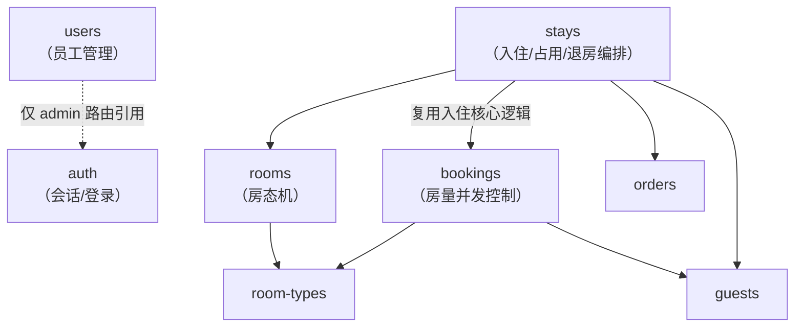
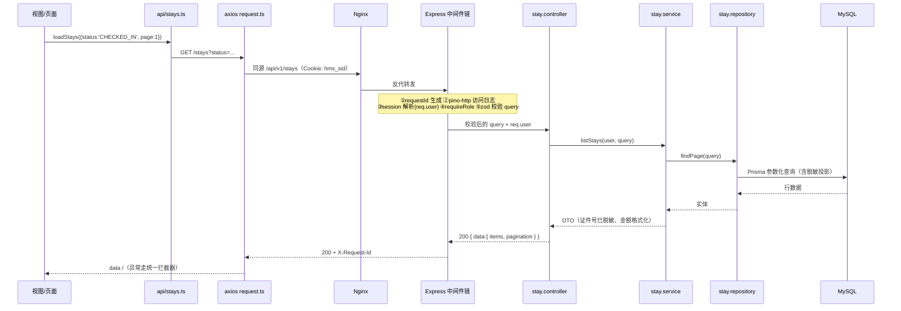

# 技术架构设计 — 酒店管理系统（HMS）

| 项 | 值 |
| --- | --- |
| 文档版本 | v1.0（待评审，未冻结） |
| 日期 | 2026-10-14 |
| 依据 | [`00-project-charter.md`](./00-project-charter.md)（经核对为《研发 Agent 通用执行协议》，仅含技术栈与过程约束，**无业务需求内容**）；业务需求基线缺失，本文所有需求编号均为架构师拟定的 **假设基线**（标记为【假设】），批准前不得视为冻结 |
| 配套文档 | [database-design.md](./database-design.md) · [api-contract.md](./api-contract.md) · [security-design.md](./security-design.md) · [development-plan.md](./development-plan.md) · [requirements-traceability.md](./requirements-traceability.md) · [../openapi/openapi.yaml](../openapi/openapi.yaml) |

---

## 1. 总体架构

### 1.1 架构总览

```mermaid
flowchart LR
    subgraph Browser["浏览器（前台 / 管理员）"]
        SPA["Vue 3 SPA<br/>Element Plus + Pinia + Vue Router"]
    end

    subgraph Compose["Docker Compose（单机部署）"]
        subgraph WebC["web 容器（Nginx）"]
            STATIC["静态资源托管（apps/web/dist）"]
            PROXY["Nginx 443 TLS / 80→301<br/>/api/* → api:3000（同源）"]
        end
        subgraph ApiC["api 容器（Node.js 22 LTS + Express + TS）"]
            MW["横切中间件链<br/>requestId / 日志 / session 解析 / CSRF 校验 / zod 校验 / 限流"]
            subgraph Mods["业务模块（模块化单体）"]
                AUTH["auth"]
                USR["users"]
                RT["room-types"]
                RM["rooms"]
                GS["guests"]
                BK["bookings"]
                ST["stays"]
                OD["orders"]
            end
            SHARED["shared 基础设施<br/>ApiError / 仓储基类 / 加密 / 审计"]
        end
        subgraph DbC["mysql 容器（MySQL 8.4 LTS）"]
            DB[("hotel 业务库<br/>InnoDB")]
        end
    end

    SPA -->|"HTTPS（同源）静态资源"| STATIC
    SPA -->|"HTTPS /api/v1/*（HttpOnly Cookie）"| PROXY
    PROXY --> MW
    MW --> Mods
    Mods --> SHARED
    SHARED -->|"Prisma（参数化 SQL）"| DB
```



### 1.2 组件职责边界

| 组件 | 职责 | 明确 **不做** 的事 |
| --- | --- | --- |
| **前端 SPA（apps/web）** | 界面渲染、路由、表单即时校验、请求编排、 loading/空态/异常态展示、基于角色的 **界面级** 权限呈现 | 不做任何安全决策：隐藏按钮、路由拦截只是 UX；不存储明文密码/密钥；不做业务规则最终裁决（房量、房态、金额一律以后端结果为准） |
| **后端 API（apps/server）** | 唯一可信的业务规则执行者：认证授权、运行时参数校验、业务状态机、事务与并发控制、价格计算、数据脱敏、日志与审计 | 不做会话状态之外的任何有状态计算（无内存缓存业务数据）；不渲染 HTML；不直接暴露数据库实体（须经 DTO 转换） |
| **数据库（MySQL 8.4）** | 数据持久化、事务隔离（InnoDB 行锁）、唯一约束/外键/CHECK 兜底（防超售、防同房同日双占用） | 不含业务存储过程/触发器（逻辑全部在服务层可测） |
| **部署环境（Docker Compose）** | 单机编排：web / api / mysql 三容器 + 数据卷、健康检查、启动时自动执行 `prisma migrate deploy` | 不引入 K8s、消息队列、Redis、网格等本规模不需要的设施 |
| **packages/shared（契约包）** | 前后端共同引用的 TypeScript 类型、zod schema、枚举与状态机常量、错误码表 | 不含任何运行时副作用代码，保证两端可安全依赖 |

### 1.3 模块划分与依赖关系

后端按业务域划分模块，模块间只允许通过 **服务层接口** 依赖，禁止跨模块直接访问对方仓储：



**依赖规则（由 ESLint `no-restricted-imports` 强制）：**

1. 路由层 → 控制器 → 服务层 → 仓储层，单向依赖；任何跨层调用（如控制器直接 import Prisma）视为违规。
2. 模块 A 引用模块 B 只允许 `import { bService } from '../b/b.service'`；禁止 `import { bRepository }` 或 `import { PrismaClient }` 于服务层之外。
3. `stays` 是业务编排根（退房事务横跨 stay/room/order），`orders` 不反向依赖 `stays` 之外的模块。

### 1.4 为什么是模块化单体

1. **规模匹配**：单店/少量门店的小型 PMS，注册用户（员工）≤ 几十人，QPS 极低（<10）。模块化单体在 `apps/server` 内以目录为边界，成本最低且演进路径清晰。
2. **事务一致性天然简单**：预订房量、入住占用、退房结算是跨聚合事务，单体 + 单库本地事务即可保证 ACID；拆分服务将立刻引入分布式事务/最终一致问题。
3. **团队与交付**：小团队、单人可全栈交付，一个进程、一次构建、一条部署流水线。
4. **保留演进能力**：模块边界 = 未来拆分边界（服务层接口稳定、仓储层隔离 ORM），但 **现在不拆**。

### 1.5 为什么不采用微服务

| 维度 | 微服务的代价（本系统） | 结论 |
| --- | --- | --- |
| 部署复杂度 | 需服务发现/网关/多容器编排，运维成本远超单人小团队承受力 | 不采用 |
| 数据一致性 | 预订-入住-退房跨域事务需 Saga/TCC，引入最终一致窗口，与"防超售"强一致诉求直接冲突 | 不采用 |
| 开发效率 | 跨仓库/跨进程联调、契约版本管理、重复脚手架 | 不采用 |
| 故障半径 | 单机小系统下，多进程反而放大故障面（网络抖动、时钟、重试幂等） | 不采用 |

**触发重新评估的条件**（写入演进预案）：多门店多租户 SaaS 化、独立报表/计费团队出现、单库写入成为瓶颈。

### 1.6 数据流与请求处理流程

**读请求（以"查询在住列表"为例）：**



**写请求（以"退房结算"为例）的关键点**：控制器只做编解码；`stay.service.checkout()` 内开启 `prisma.$transaction`，对 stay、room 行执行 `SELECT ... FOR UPDATE`，完成状态机校验 → 计费 → 生成订单 → 房态变更 → 释放占用，任一步失败整体回滚。详见 [database-design.md §6](./database-design.md)。

### 1.7 身份认证与授权流程

方案：**服务器端 Session + HttpOnly Cookie（单一认证方案，不叠加 JWT）**，论证见附录 ADR-002。

```mermaid
sequenceDiagram
    participant U as 浏览器
    participant L as POST /auth/login
    participant DB as MySQL

    U->>L: { username, password }
    Note over L: IP 限流 → 查 user → 锁定检查<br/>→ bcrypt.compare
    alt 凭证错误
        L-->>U: 401 INVALID_CREDENTIALS（统一文案，计数+1）
    else 锁定期内
        L-->>U: 423 ACCOUNT_LOCKED
    else 成功
        Note over L,DB: 事务：清零 failed_attempts、<br/>写 sessions(id, user_id, expires_at=now+8h)
        L-->>U: 200 + Set-Cookie: hms_sid=<256bit><br/>HttpOnly; SameSite=Strict; Secure(生产); Path=/
        U->>U: 后续请求自动携带 Cookie
    end
```

**每个受保护请求的鉴权管道（后端唯一安全边界）：**

1. `sessionMiddleware`：解析 `hms_sid` → 查 `sessions`（未过期且 user.status=ACTIVE）→ 注入 `req.user`；否则匿名。
2. `requireAuth`：无 `req.user` → `401 SESSION_EXPIRED`。
3. `requireRole(...roles)`：角色不匹配 → `403 FORBIDDEN`。
4. `csrfMiddleware`：非 GET/HEAD 请求校验 `Origin` 头与部署源一致（防跨站提交）。
5. 资源级校验（如"停用自己账号"）由各服务层显式拒绝。

**会话生命周期**：8 小时绝对过期【假设 A-11】；登出删除 sessions 行并清除 Cookie；每小时定时清理过期行；禁用员工即时踢出（session 每请求实时查库，不缓存）。

**权限矩阵（角色为假设 A-01，待批准）：**

| 功能域 | RECEPTIONIST（前台） | ADMIN（管理员） |
| --- | --- | --- |
| 登录/登出/我的信息 | ✓ | ✓ |
| 房型/客房查看、房态操作（清洁完成） | ✓ | ✓ |
| 房型/客房维护、维修/停用、员工管理 | ✗ | ✓ |
| 客人档案读写 | ✓ | ✓ |
| 预订创建/取消/NO_SHOW/入住 | ✓ | ✓ |
| 直接入住/退房结算 | ✓ | ✓ |
| 订单查询 | ✓ | ✓ |

---

## 2. 前端设计（apps/web）

技术栈：Vue 3（`<script setup>`）+ TypeScript（strict）+ Vite + Element Plus + Pinia + Vue Router。契约类型全部来自 `@hms/shared`，**禁止前端手写接口类型**。

### 2.1 目录结构

```
apps/web/
├── index.html
├── vite.config.ts            # dev proxy: /api → http://localhost:3000
├── .env.example              # VITE_API_BASE_URL=/api/v1
├── src/
│   ├── main.ts
│   ├── App.vue
│   ├── api/                  # 每域一个模块，仅做 HTTP 编解码
│   │   ├── request.ts        # axios 实例 + 拦截器（见 2.4）
│   │   ├── auth.ts  users.ts  room-types.ts  rooms.ts
│   │   ├── guests.ts  bookings.ts  stays.ts  orders.ts
│   ├── components/
│   │   ├── DataPage.vue      # 列表页三态容器（loading/error/empty）
│   │   ├── StatusTag.vue     # 统一状态→颜色（映射表来自 @hms/shared）
│   │   ├── PaginationBar.vue
│   │   ├── ConfirmDialog.vue
│   │   ├── GuestPicker.vue   # 客人搜索/选择（预订、入住复用）
│   │   ├── RoomPicker.vue    # 可用房选择（按房型+日期查可用房）
│   │   └── CheckoutDialog.vue# 退房结算（费用预览+杂费录入）
│   ├── composables/
│   │   ├── usePagedList.ts   # 分页/排序/刷新/loading/error/empty
│   │   └── useFormSubmit.ts  # 提交 loading + 错误分流（ElMessage/表单映射）
│   ├── layouts/
│   │   ├── DefaultLayout.vue # 侧边栏+顶栏（菜单按角色过滤）
│   │   └── AuthLayout.vue
│   ├── router/
│   │   ├── index.ts          # createRouter + 全局守卫
│   │   └── guards.ts         # 认证/授权守卫（见 2.9）
│   ├── stores/
│   │   ├── auth.ts
│   │   └── ui.ts             # 侧边栏折叠等界面态（localStorage）
│   ├── types/                # 仅页面局部类型；接口类型一律 import '@hms/shared'
│   ├── utils/format.ts       # 金额/日期/证件掩码展示
│   └── views/
│       ├── login/LoginView.vue
│       ├── rooms/RoomsView.vue          # 房态总览（卡片网格）
│       ├── room-types/RoomTypesView.vue # 房型管理（ADMIN）
│       ├── guests/GuestsView.vue
│       ├── bookings/BookingListView.vue
│       ├── bookings/BookingDetailView.vue
│       ├── stays/StayListView.vue       # 在住列表 + walk-in 入口
│       ├── stays/StayDetailView.vue     # 详情 + 退房入口
│       ├── orders/OrderListView.vue
│       ├── orders/OrderDetailView.vue
│       ├── users/UsersView.vue          # 员工管理（ADMIN）
│       └── error/ForbiddenView.vue  NotFoundView.vue
```

### 2.2 路由与页面

| 路由 | 视图 | meta.roles | 说明 |
| --- | --- | --- | --- |
| `/login` | LoginView | 公开 | 已登录访问时重定向 `/rooms` |
| `/` | → `/rooms` | — | 重定向 |
| `/rooms` | RoomsView | 全角色 | 房态看板：按房型分组卡片，含在住客人摘要；操作：清洁完成、（ADMIN）维修/停用 |
| `/room-types` | RoomTypesView | ADMIN | 房型 CRUD + 归档 |
| `/guests` | GuestsView | 全角色 | 档案查询（关键字）/新建/编辑；证件号掩码展示 |
| `/bookings` | BookingListView | 全角色 | 状态筛选、日期筛选、创建预订、取消/NO_SHOW/办理入住入口 |
| `/bookings/:id` | BookingDetailView | 全角色 | 详情 + 操作（按状态渲染） |
| `/stays` | StayListView | 全角色 | 在住/已退筛选；walk-in 直接入住对话框 |
| `/stays/:id` | StayDetailView | 全角色 | 费用累计、押金、退房结算（CheckoutDialog） |
| `/orders`、`/orders/:id` | Order 列表/详情 | 全角色 | 查询只读 |
| `/users` | UsersView | ADMIN | 员工创建/启停/重置密码 |
| `/403`、`/:pathMatch(.*)*` | 错误页 | — | 403 / 404 兜底 |

守卫逻辑见 2.9；列表查询参数（页码、筛选）同步到 URL query，支持刷新还原与分享定位。

### 2.3 布局与公共组件

- `DefaultLayout`：左侧菜单（角色过滤，来自 `shared/permissions.ts` 的菜单-角色映射）、顶栏（当前用户、登出、修改密码入口）、主区 `<router-view>`。
- `DataPage.vue`：统一承载 **加载/空/异常三态**（见 2.10），页面只传入 `status / error / onRetry` 与默认插槽。
- 表单类公共组件不抽大象：`GuestPicker`、`RoomPicker`、`CheckoutDialog` 是被 ≥2 个页面复用的业务组件；单页面表单内联在视图中，避免过早抽象。

### 2.4 API 请求封装（api/request.ts）

```ts
// 形态示意（非最终实现）
export const http = axios.create({
  baseURL: import.meta.env.VITE_API_BASE_URL, // '/api/v1'
  timeout: 15_000,
  withCredentials: true, // 携带 HttpOnly Cookie
})
```

拦截器职责（唯一的横切位置，业务代码不直接 catch HTTP 细节）：

| 场景 | 处理 |
| --- | --- |
| 网络失败 / 超时 | 读操作 → 页面进入 ErrorState；写操作 → `ElMessage.error('网络异常，请稍后重试')` |
| 401 | 清空 authStore → 跳转 `/login?redirect=...`（防死循环：登录页请求豁免） |
| 403 | `ElMessage.error('无权限执行该操作')` |
| 404 | 列表 → 空态提示；详情 → NotFoundView |
| 409（业务冲突，如房量不足/房间占用） | `ElMessage.error(后端 error.message)`，由调用方决定是否刷新数据 |
| 422 | 将 `error.details[].field` 映射回 `ElForm` 对应项 `validateField` 展示字段级错误 |
| 5xx | `ElMessage.error('服务异常')` + 展示 `X-Request-Id` 便于报障 |
| 成功 | 直接返回 `data.data`（去掉统一信封），列表返回 `{ items, pagination }` |

不做自动重试（写操作幂等性无法保证）；导出的 api 函数签名一律使用 `@hms/shared` 类型。

### 2.5 Pinia 状态管理

| Store | 状态 | 动作 | 说明 |
| --- | --- | --- | --- |
| `useAuthStore` | `user: SessionUser \| null`、`booted: boolean` | `login / logout / fetchMe` | **唯一的登录态来源**；不持久化到 localStorage（防伪造），刷新后由守卫触发 `fetchMe` 重建 |
| `useUiStore` | 侧边栏折叠等 | — | localStorage 持久化，纯界面态 |

列表/详情数据 **不进全局 store**，由 `usePagedList` / `useFormSubmit` 组合式函数在页面作用域管理，避免大而全的 store 与脏数据问题（经验：跨页共享列表缓存的维护成本 > 收益）。

### 2.6 表单校验（三层，契约同源）

1. **即时层**：Element Plus `rules`（required / pattern / 长度），规则常量从 `@hms/shared` 的 zod schema 派生描述（如 `bookingFormRules`）。
2. **提交前层**：调用 `shared` 同一份 zod schema `safeParse`，失败即阻断并映射字段错误。
3. **服务端层**：后端 zod 校验 + 业务校验（房量、状态机），返回 422 details。

三层使用 **同一份 schema 定义**，杜绝"前端宽松、后端严格"或反之的漂移。

### 2.7 登录状态处理

- 应用启动：`router.beforeEach` 中若 `!authStore.booted` → `await fetchMe()`（200 重建会话 / 401 置游客态），完成后放行。
- 会话过期：任意请求 401 → 统一跳登录（携带 `redirect`，校验以 `/` 开头且非 `//` 防开放重定向）。
- 主动登出：调用 `POST /auth/logout` → 清 store → 跳登录（即使请求失败也本地清态）。
- 登录页提交：失败展示后端统一错误文案；连续失败提示"多次失败将锁定 15 分钟"（NFR-SEC-003）。

### 2.8 统一错误提示

- 全局唯一出口在 `request.ts` 拦截器 + `useFormSubmit`，页面 **不得** 自行 `console.error` 吞错或散落 `ElMessage`。
- 用户可见文案遵循错误码表（api-contract.md §3）；前端不翻译 5xx 细节，展示 requestId。
- 字段级（422）与消息级（409/403）分流，禁止同一错误弹两次。

### 2.9 权限控制（前端边界声明）

- **菜单/路由**：`meta.roles` + 全局守卫；未登录 → `/login`；已登录但角色不符 → `/403`（不重定向到登录页，避免误导）。
- **按钮/操作**：`v-permission="'ADMIN'"` 指令（本质是 `v-if` 封装）控制渲染。
- **⚠️ 安全边界声明**：以上均为 UX 优化。**隐藏按钮、禁用路由不是权限控制**；所有受保护 API 由后端 `requireAuth/requireRole` + 服务层资源校验独立裁决（协议实现规则 5）。前端权限泄露不构成安全事件，后端权限缺失构成。

### 2.10 加载、空状态与异常状态

| 状态 | 呈现 | 规范 |
| --- | --- | --- |
| 加载（首屏） | 骨架屏（列表）/ 按钮 loading（提交） | 提交中禁用表单，防重复提交 |
| 加载（翻页） | 表格 `v-loading` | 不整页遮罩 |
| 空状态 | `DataPage` 内置 `el-empty`，文案区分"暂无数据"与"筛选无结果（含清空筛选按钮）" | |
| 异常状态 | ErrorState 图标 + 简述 + **重试按钮**（读操作）；写操作失败仅 ElMessage | 5xx 附 requestId |
| 404/403 | 独立视图 | 详情页 id 不存在 → 404 视图 |

---

## 附录：架构决策记录（ADR）

> 状态：全部为 v1.0 提议，随文档评审一并批准。格式：背景 → 决策 → 理由 → 代价/风险 → 被否决的替代方案。

### ADR-001 模块化单体（而非微服务）
- **决策**：单进程 Express 应用，按业务域分模块目录，服务层接口为模块边界。
- **理由**：见 §1.4/§1.5；核心是跨域强一致事务与单人团队运维成本。
- **代价**：模块边界仅靠 lint/评审约束，存在腐化风险 → 以 ESLint `no-restricted-imports` + CI 依赖检查兜底；未来拆分需偿还边界纪律债。
- **否决**：微服务（分布式事务与运维成本不成比例）。

### ADR-002 服务器端 Session + HttpOnly Cookie（而非 JWT）
- **决策**：自研 `sessions` 表 + 256-bit 随机 sid + `HttpOnly; SameSite=Strict; Secure(生产)` Cookie；8h 过期；每请求实时查库。
- **理由**：单实例部署无无状态需求；可即时吊销（禁用员工/登出立即生效）；凭证不出现在 JS 可读存储，天然抗 XSS 窃取；协议要求"不无理由叠加多种认证方案"，单方案最简。
- **代价**：每请求一次 session 查询（有索引，微秒级，可接受）；横向扩容时需引入共享存储（Redis）或粘性会话——已列入触发重评条件。
- **否决**：JWT Bearer（无法即时吊销，refresh token 机制反而引入两套凭证复杂度）；JWT+Session 混用（违反协议）。

### ADR-003 Prisma 7 + Prisma Migrate（而非 TypeORM/原生 SQL/其他）
- **决策**：沿用协议锁定版本 Prisma 7；schema.prisma 为库结构唯一事实来源；迁移一律 `prisma migrate` 生成 SQL 入库。
- **理由**：类型安全的查询 API；迁移工具内建且产出可审查的 SQL；协议已锁定。
- **代价/风险**：Prisma 7 较新，generator（`prisma-client`）/ESM 配置与 Express + tsx 编译链的兼容性需在 T-01 做 PoC；Prisma schema 不支持 MySQL `CHECK` 约束 → 以 `--create-only` 迁移手写 SQL 补充（见 database-design.md §7）。若 PoC 失败，按协议上报证据并提议降级 Prisma 6 LTS，不得擅自变更。
- **否决**：TypeORM（装饰器 + 迁移质量差）；Sequelize（类型弱）。

### ADR-004 pnpm monorepo + `@hms/shared` 契约包
- **决策**：`apps/web`、`apps/server`、`packages/shared` 三包 workspace；接口 DTO 类型、zod schema、枚举/状态机常量、错误码表全部放 shared，两端 `import` 同一份。
- **理由**：直接满足"接口必须前后端共同引用、不允许各自猜测响应格式"；类型漂移在编译期暴露。
- **代价**：需要 workspace 构建顺序管理（shared 无构建产物，source 直引 + `exports` 字段）；CI 需同时跑两端检查。
- **否决**：双仓库（契约同步靠人肉，必然漂移）；仅用 openapi-typescript 生成（无法覆盖运行时校验与状态机常量）。

### ADR-005 防超售：房型行锁 + 重叠计数（而非库存计数表/房间级预订）
- **决策**：创建/取消预订事务内 `SELECT ... FOR UPDATE` 锁房型行 → 统计重叠日期的 CONFIRMED 预订数 → 与可售房数比较；影响房量的房间管理操作同样先锁房型行。
- **理由**：无库存快照表可维护（避免 total 与 room 表不同步）；InnoDB 行锁将同房型并发预订完全串行化，正确性证明简单；小规模下吞吐完全够用。
- **代价**：同房型高并发预订排队（小酒店毫秒级，可忽略）；并发正确性必须有集成测试（开发计划 T-09）。
- **否决**：按天库存计数表（需定时任务维护快照、易漂移）；按具体房间预订 + 排除约束（MySQL 不支持 EXCLUDE，区间重叠无法用唯一约束表达）；仅乐观重试（存在竞态窗口）。

### ADR-006 同房同日占用：`room_occupancy(room_id, date)` 唯一约束（数据库层兜底）
- **决策**：入住时为 `[入住日, 预计离店日)` 逐日插入占用行，`UNIQUE(room_id, date)` 由数据库拒绝一切重复占用，即使应用存在 bug。
- **理由**：协议要求并发防护不能仅靠应用判断；唯一约束是不可绕过的最后防线。区间左闭右开支持退房日当日再售。
- **代价**：退房需删除剩余占用行（在退房事务内完成）；每次入住产生 ≤N 行写入（N=晚数，量小）。
- **否决**：仅事务内 overlap 查询（应用 bug 时无兜底）。

### ADR-007 zod 作为唯一运行时校验库（前后端同源）
- **决策**：所有外部输入（body/query/param/env）经 shared zod schema 校验；环境变量启动时 fail-fast 校验。
- **理由**：TS 类型是编译期的，运行时边界必须有独立防线（协议实现规则 4）；同源 schema 保证两端规则一致。
- **代价**：shared 包需同时兼容 Node 与浏览器（纯 JS 依赖，无碍）。
- **否决**：class-validator（装饰器、前后端不可共享）；仅 Element Plus 前端校验（可被绕过）。

### ADR-008 密码哈希 bcrypt（cost=12），证件号 AES-256-GCM + HMAC 查重
- **决策**：`bcryptjs` cost 12；证件号应用层 AES-256-GCM 加密存储、HMAC-SHA256 列做等值查重（唯一键）、API 一律返回掩码。
- **理由**：bcrypt 抗 GPU、生态成熟、纯 JS 免原生编译问题（Alpine 容器友好）；证件号属 PII，等值查找需求决定"加密+确定性 HMAC 索引列"组合。
- **代价**：密钥来自环境变量，轮换需重加密迁移（本期不做，登记风险）；bcryptjs 慢于原生 bcrypt（登录频率极低，可接受）。
- **否决**：明文/可逆 base64（不可接受）；scrypt（Node 内建但生态一致性弱）；只加密不建 HMAC 索引（无法查重）。

### ADR-009 统一响应信封：成功裸 `data`，错误 `{ error:{ code,message,details } }` + 语义化 HTTP 状态码
- **决策**：成功 `200 { "data": ... }`（列表 `{ items, pagination }`）；失败使用 400/401/403/404/409/422/423/500 + 业务错误码。
- **理由**：HTTP 状态码先被网关/监控/前端拦截器消费；业务错误码保证语义精确（如 `ROOM_TYPE_SOLD_OUT`）；结构最小化。
- **代价**：无（前后端均从 shared 类型引用，不存在猜测）。
- **否决**：全 200 + body code（浪费 HTTP 语义）；每域自定义信封（漂移）。

### ADR-010 单机 Docker Compose（web/api/mysql 三容器）+ 前置 Nginx 同源反代
- **决策**：Nginx 同时托管 SPA 静态资源与 `/api` 反代（单源）；D2-a/b 下由 `web` 容器内 Nginx 终结 TLS（443），80 仅 301 跳转，证书通过 `TLS_CERT_DIR` 只读挂载。
- **理由**：同源部署使 `SameSite=Strict` Cookie 与 Origin 校验的 CSRF 防线成立，免去跨域 Cookie 的 `SameSite=None; Secure` 依赖；协议指定 Compose 部署。
- **代价**：单机无 HA（小酒店可接受）；生产需提供域名/受信证书，私钥需最小权限保管。
- **否决**：前后端独立域名（跨域 Cookie 复杂化且弱化 CSRF 防线）；K8s（过度）。

### ADR-011 日志与追踪：pino + pino-http + requestId
- **决策**：结构化 JSON 日志；每请求生成 `X-Request-Id` 并贯穿日志上下文与错误响应；敏感字段（password/idNumber/cookie）redact。
- **理由**：问题可定位（用户报障提供 requestId 即可检索全链路）；协议要求日志过滤敏感信息。
- **代价**：JSON 日志对人读不友好 → 开发环境 `pino-pretty`。
- **否决**：console.log（无结构、无级别、无脱敏）。
