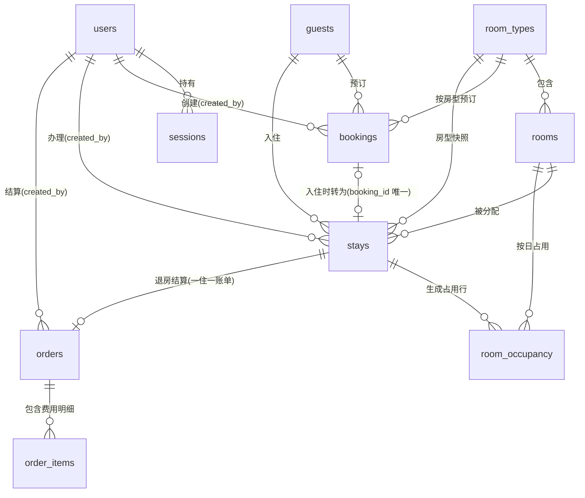
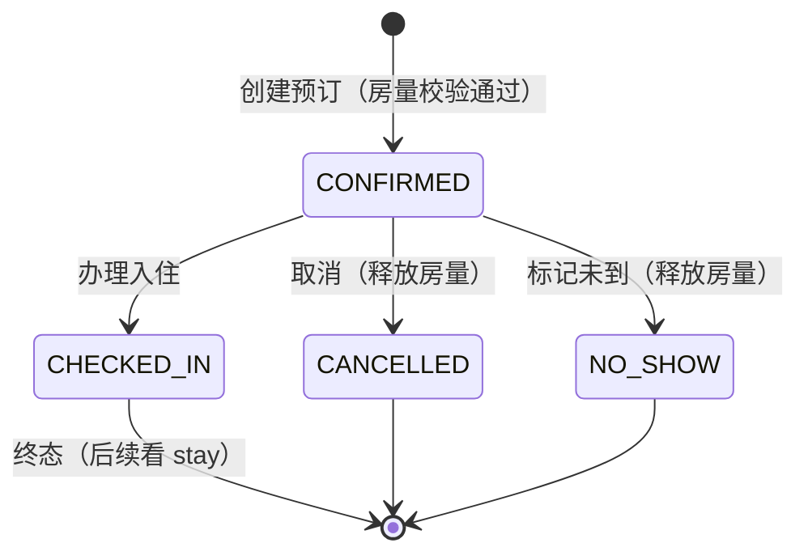
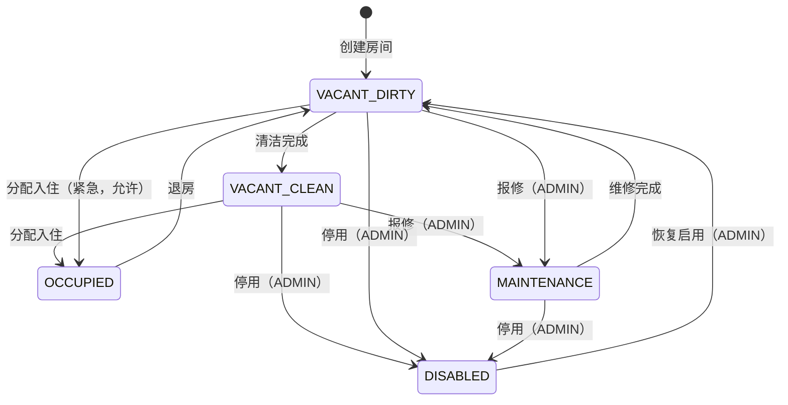
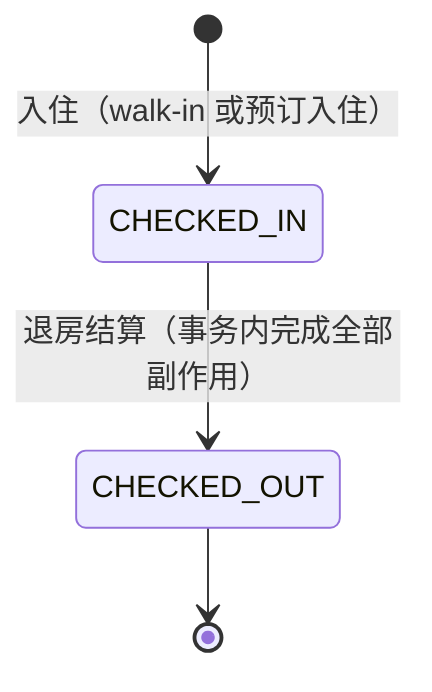
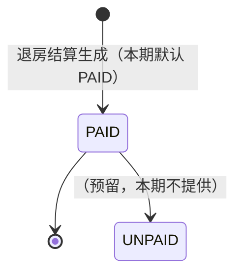

# 数据库设计 — 酒店管理系统（HMS）

| 项 | 值 |
| --- | --- |
| 文档版本 | v1.0（待评审，未冻结） |
| 数据库 | MySQL 8.4 LTS，InnoDB，`utf8mb4` / `utf8mb4_0900_ai_ci` |
| ORM | Prisma 7（`schema.prisma` 为结构唯一事实来源，见架构 ADR-003） |
| 日期 | 2026-10-14 |

**通用约定**

- 所有表主键 `id BIGINT UNSIGNED AUTO_INCREMENT`。
- 所有业务表含 `created_at DATETIME(3) NOT NULL`、`updated_at DATETIME(3) NOT NULL`（应用层写入；Prisma `@updatedAt` 自动维护 `updated_at`，`@default(now())` 维护 `created_at`）。时间戳 **一律 UTC 存储**【假设 A-10】。
- 业务"日历日"（入住日/离店日）用 `DATE` 类型，语义为酒店本地日历日（Asia/Shanghai）【假设 A-10】。
- 金额一律 `DECIMAL(10,2)`，币种 CNY【假设 A-09】；禁止 FLOAT/DOUBLE。
- 外键均显式声明；业务主数据（guest/room_type/room/user）`ON DELETE RESTRICT`，从属数据（room_occupancy→stay、sessions→user）`ON DELETE CASCADE`。业务数据 **不做物理删除**，用状态字段软停用。
- 表名复数蛇形（`room_types`…），Prisma model 用 PascalCase + `@@map`。

---

## 1. ER 图



**核心关系语义（重点分析）：**

1. **客房 room → 房型 room_type（N:1，聚合根）**：房间是物理实体，房型是销售单元。**预订针对房型（不锁具体房间），入住才分配具体房间**【假设 A-03】——这是防超售与排房解耦的关键。
2. **客人 guest → 预订/入住（1:N，档案复用）**：预订与入住都必须挂接已存在的客人档案（先建/查重档案，后交易），证件号 `(id_type, id_number_hash)` 唯一保证一人一档。
3. **预订 booking → 入住 stay（1:0..1，`booking_id` 可空且唯一）**：walk-in 入住的 stay 无预订；预订入住的 stay 恰好对应一条预订（`UNIQUE(booking_id)` 在数据库层保证一订一住，防重复办理入住）。
4. **入住 stay → 客间占用 room_occupancy（1:N 按天物化）**：把"时间区间占用"物化为逐日行，用 `UNIQUE(room_id, date)` 让数据库直接拒绝同房同日双占用（ADR-006）。区间左闭右开 `[入住日, 预计离店日)`【假设 A-05】。
5. **入住 stay → 订单 orders（1:1）**：退房时生成，`UNIQUE(stay_id)` 保证一次入住只有一张账单；费用明细落 `order_items`（含房费、杂费、押金抵扣三类）。
6. **预订/入住的价格快照**：`bookings.price_per_night`、`stays.price_per_night` 在创建时从房型 `base_price` 锁定（入住时可人工覆盖），房型后续调价不影响存量【假设 A-12/A-13】。

## 2. 表结构明细

> 以下为设计规格（等价 DDL 语义）。`*` 必填。Prisma 不支持 CHECK，`chk_*` 约束通过迁移 SQL 手写补充（§7）。

### 2.1 users（员工）

| 字段 | 类型 | 约束 | 说明 |
| --- | --- | --- | --- |
| id | BIGINT UNSIGNED AI | PK | |
| username* | VARCHAR(50) | **UNIQUE** | 登录名，`^[a-zA-Z0-9_]{3,50}$` |
| password_hash* | VARCHAR(100) | NOT NULL | bcrypt(cost=12) |
| display_name* | VARCHAR(50) | NOT NULL | 姓名 |
| role* | ENUM('ADMIN','RECEPTIONIST') | NOT NULL | 【假设 A-01】 |
| status* | ENUM('ACTIVE','DISABLED') | NOT NULL DEFAULT 'ACTIVE' | 软停用 |
| failed_attempts* | INT | NOT NULL DEFAULT 0 | 连续登录失败计数 |
| locked_until | DATETIME(3) | NULL | 账户锁定截止（NFR-SEC-003） |
| last_login_at | DATETIME(3) | NULL | |
| created_at / updated_at* | DATETIME(3) | NOT NULL | |

### 2.2 sessions（会话）

| 字段 | 类型 | 约束 | 说明 |
| --- | --- | --- | --- |
| id | CHAR(64) | PK | 32 字节随机数的 hex（256-bit） |
| user_id* | BIGINT UNSIGNED | FK → users.id, CASCADE | |
| expires_at* | DATETIME(3) | NOT NULL | 创建 + 8h【假设 A-11】 |
| created_at* | DATETIME(3) | NOT NULL | |

索引：`INDEX idx_sessions_expires (expires_at)`（定时清理用）、`INDEX idx_sessions_user (user_id)`。

### 2.3 room_types（房型）

| 字段 | 类型 | 约束 | 说明 |
| --- | --- | --- | --- |
| id | BIGINT UNSIGNED AI | PK | |
| code* | VARCHAR(20) | **UNIQUE** | 如 `STD`、`DLX` |
| name* | VARCHAR(50) | NOT NULL | 如 标准大床房 |
| base_price* | DECIMAL(10,2) | NOT NULL | 基准房价；`CHECK (base_price >= 0)` |
| capacity* | TINYINT UNSIGNED | NOT NULL | 可住人数；`CHECK (capacity BETWEEN 1 AND 20)` |
| description | VARCHAR(500) | NULL | |
| status* | ENUM('ACTIVE','ARCHIVED') | NOT NULL DEFAULT 'ACTIVE' | 归档=不再可售（不物理删） |
| created_at / updated_at* | DATETIME(3) | NOT NULL | |

### 2.4 rooms（客房）

| 字段 | 类型 | 约束 | 说明 |
| --- | --- | --- | --- |
| id | BIGINT UNSIGNED AI | PK | |
| room_number* | VARCHAR(20) | **UNIQUE** | 如 `8201` |
| room_type_id* | BIGINT UNSIGNED | FK → room_types.id, RESTRICT | |
| status* | ENUM('VACANT_CLEAN','VACANT_DIRTY','OCCUPIED','MAINTENANCE','DISABLED') | NOT NULL DEFAULT 'VACANT_DIRTY' | 状态机见 §5.2 |
| note | VARCHAR(200) | NULL | |
| created_at / updated_at* | DATETIME(3) | NOT NULL | |

索引：`INDEX idx_rooms_type (room_type_id, status)`。

**可售房数定义**：`COUNT(rooms WHERE room_type_id=? AND status NOT IN ('MAINTENANCE','DISABLED'))`。OCCUPIED 计入可售基数——房量控制只防"预订总量超物理房量"，在住/已订合并视角由 §6.1 步骤 3 的重叠计数统一保证。

### 2.5 guests（客人档案）

| 字段 | 类型 | 约束 | 说明 |
| --- | --- | --- | --- |
| id | BIGINT UNSIGNED AI | PK | |
| name* | VARCHAR(100) | NOT NULL | |
| phone* | VARCHAR(20) | NOT NULL | |
| id_type* | ENUM('ID_CARD','PASSPORT','OTHER') | NOT NULL | |
| id_number_hash* | CHAR(64) | **UNIQUE(id_type, id_number_hash)** | HMAC-SHA256(证件号)，密钥来自 env；用于等值查重 |
| id_number_cipher* | VARBINARY(255) | NOT NULL | AES-256-GCM 密文（`iv(12) ‖ tag(16) ‖ ciphertext`），仅服务层解密 |
| remark | VARCHAR(500) | NULL | |
| created_at / updated_at* | DATETIME(3) | NOT NULL | |

索引：`INDEX idx_guests_name (name)`、`INDEX idx_guests_phone (phone)`。
**API 永不返回明文证件号**，只返回掩码（前 1 后 1，中间 `*`），掩码在响应时由密文解密计算，不落库【假设 A-08】。

### 2.6 bookings（预订）

| 字段 | 类型 | 约束 | 说明 |
| --- | --- | --- | --- |
| id | BIGINT UNSIGNED AI | PK | 对外展示号由前端格式化为 `BK-{id:06d}` |
| guest_id* | BIGINT UNSIGNED | FK → guests.id, RESTRICT | |
| room_type_id* | BIGINT UNSIGNED | FK → room_types.id, RESTRICT | 预订按房型【假设 A-03】 |
| check_in_date* | DATE | NOT NULL | `CHECK (check_in_date >= CURDATE() - INTERVAL 1 DAY)`（允许修改当日预订，见 §6.1 注） |
| check_out_date* | DATE | NOT NULL | `CHECK (check_out_date > check_in_date)` |
| room_count* | TINYINT UNSIGNED | NOT NULL DEFAULT 1 | 本期恒为 1【假设 A-04】，字段保留 |
| price_per_night* | DECIMAL(10,2) | NOT NULL | 创建时锁定（默认取房型 base_price，可覆盖） |
| total_price* | DECIMAL(10,2) | NOT NULL | = price_per_night × room_count × nights（快照） |
| status* | ENUM('CONFIRMED','CHECKED_IN','CANCELLED','NO_SHOW') | NOT NULL DEFAULT 'CONFIRMED' | 状态机见 §5.1 |
| note | VARCHAR(500) | NULL | |
| created_by* | BIGINT UNSIGNED | FK → users.id, RESTRICT | |
| cancelled_at | DATETIME(3) | NULL | |
| cancel_reason | VARCHAR(200) | NULL | |
| created_at / updated_at* | DATETIME(3) | NOT NULL | |

索引（防超售重叠查询专用）：`INDEX idx_bookings_capacity (room_type_id, status, check_in_date, check_out_date)`；`INDEX idx_bookings_guest (guest_id)`；`INDEX idx_bookings_checkin (check_in_date, status)`。

> **实现说明（T-07，2026-10-14）**：`CHECK (check_in_date >= CURDATE() - INTERVAL 1 DAY)` 无法落库——MySQL 8.4 禁止 CHECK 约束使用非确定性函数（实测报错 ERROR 3814: disallowed function: curdate）。该项改由 T-09 预订服务层校验；`CHECK (check_out_date > check_in_date)` 等其余约束已按设计通过迁移手写 SQL 落库（见 `prisma/migrations/*_business_tables`）。

### 2.7 stays（入住记录）

| 字段 | 类型 | 约束 | 说明 |
| --- | --- | --- | --- |
| id | BIGINT UNSIGNED AI | PK | 对外展示 `ST-{id:06d}` |
| booking_id | BIGINT UNSIGNED | FK → bookings.id, RESTRICT，**UNIQUE（可空）** | 一订一住；walk-in 为 NULL |
| guest_id* | BIGINT UNSIGNED | FK → guests.id, RESTRICT | |
| room_id* | BIGINT UNSIGNED | FK → rooms.id, RESTRICT | 具体房间 |
| room_type_id* | BIGINT UNSIGNED | FK → room_types.id, RESTRICT | 入住时快照（应与 room 一致，服务层校验） |
| price_per_night* | DECIMAL(10,2) | NOT NULL | 结算房价（预订价带入，可覆盖） |
| check_in_at* | DATETIME(3) | NOT NULL | 实际入住时刻 |
| expected_check_out_date* | DATE | NOT NULL | 预计离店日（来自预订或 walk-in 输入）；`CHECK (expected_check_out_date > DATE(check_in_at))` |
| actual_check_out_at | DATETIME(3) | NULL | 实际退房时刻 |
| deposit_amount* | DECIMAL(10,2) | NOT NULL DEFAULT 0 | 押金【假设 A-07】 |
| status* | ENUM('CHECKED_IN','CHECKED_OUT') | NOT NULL DEFAULT 'CHECKED_IN' | 状态机见 §5.3 |
| note | VARCHAR(500) | NULL | |
| created_by* | BIGINT UNSIGNED | FK → users.id, RESTRICT | |
| created_at / updated_at* | DATETIME(3) | NOT NULL | |

索引：`INDEX idx_stays_room (room_id, status)`；`INDEX idx_stays_guest (guest_id)`；`INDEX idx_stays_status_checkout (status, expected_check_out_date)`。

### 2.8 room_occupancy（房日占用）★ 并发核心

| 字段 | 类型 | 约束 | 说明 |
| --- | --- | --- | --- |
| id | BIGINT UNSIGNED AI | PK | |
| stay_id* | BIGINT UNSIGNED | FK → stays.id, **CASCADE** | 退房删行、stay 误删联动 |
| room_id* | BIGINT UNSIGNED | FK → rooms.id, RESTRICT | |
| date* | DATE | NOT NULL | 占用日，区间 `[check_in_date, expected_check_out_date)` |
| created_at* | DATETIME(3) | NOT NULL | |

**约束：`UNIQUE uq_occupancy_room_date (room_id, date)` ← 数据库层禁止同房同日双占用（ADR-006）**。
索引：`INDEX idx_occupancy_stay (stay_id)`、`INDEX idx_occupancy_room_date (room_id, date)`（即唯一键，兼作查询）。

### 2.9 orders（账单订单）与 order_items（费用明细）

**orders**

| 字段 | 类型 | 约束 | 说明 |
| --- | --- | --- | --- |
| id | BIGINT UNSIGNED AI | PK | 对外展示 `ORD-{id:06d}` |
| stay_id* | BIGINT UNSIGNED | FK → stays.id, RESTRICT，**UNIQUE** | 一住一账单 |
| total_amount* | DECIMAL(10,2) | NOT NULL | = SUM(ROOM_FEE + MISC 明细) |
| deposit_amount* | DECIMAL(10,2) | NOT NULL DEFAULT 0 | 该入住收取的押金（冗余自 stay，便于对账） |
| deposit_applied* | DECIMAL(10,2) | NOT NULL DEFAULT 0 | 抵扣额 = min(deposit, total)【假设 A-07】 |
| paid_amount* | DECIMAL(10,2) | NOT NULL | 实收 = total − deposit_applied |
| payment_method* | ENUM('CASH','WECHAT','ALIPAY','BANK_CARD','MIXED') | NOT NULL | |
| status* | ENUM('UNPAID','PAID') | NOT NULL DEFAULT 'PAID' | 本期退房即结，UNPAID 仅为扩展预留 |
| note | VARCHAR(500) | NULL | |
| created_by* | BIGINT UNSIGNED | FK → users.id, RESTRICT | |
| created_at / updated_at* | DATETIME(3) | NOT NULL | |

**order_items**（创建后不可修改，审计靠追加）

| 字段 | 类型 | 约束 | 说明 |
| --- | --- | --- | --- |
| id | BIGINT UNSIGNED AI | PK | |
| order_id* | BIGINT UNSIGNED | FK → orders.id, CASCADE | |
| type* | ENUM('ROOM_FEE','MISC','DEPOSIT_APPLIED') | NOT NULL | 房费 / 杂费 / 押金抵扣 |
| name* | VARCHAR(100) | NOT NULL | 摘要，如 "房费 3 晚 × 288.00"、"迷你吧" |
| amount* | DECIMAL(10,2) | NOT NULL | 恒为正数；`CHECK (amount > 0)` |
| created_at* | DATETIME(3) | NOT NULL | |

索引：`INDEX idx_orders_stay (stay_id)`（唯一键兼）、`INDEX idx_orders_created (created_at)`；`INDEX idx_items_order (order_id)`。

## 3. 唯一约束清单

| 约束 | 表 | 目的 |
| --- | --- | --- |
| `uq_users_username` | users | 登录名唯一 |
| `uq_room_types_code` | room_types | 房型代码唯一 |
| `uq_rooms_room_number` | rooms | 房号唯一 |
| `uq_guests_id_number` (id_type, id_number_hash) | guests | 一证一档 |
| `uq_bookings_booking_stay` (booking_id) | stays | 一订一住，防重复办理入住 |
| **`uq_occupancy_room_date` (room_id, date)** | room_occupancy | **防同房同日双占用（并发兜底）** |
| `uq_orders_stay` (stay_id) | orders | 一住一账单，防重复退房结算 |

## 4. 索引清单（除唯一键/PK 外）

| 索引 | 表 | 支撑查询 |
| --- | --- | --- |
| idx_sessions_expires / idx_sessions_user | sessions | 过期清理 / 登出 |
| idx_rooms_type (room_type_id, status) | rooms | 可售房数统计、房型筛选 |
| idx_guests_name / idx_guests_phone | guests | 关键字检索 |
| **idx_bookings_capacity (room_type_id, status, check_in_date, check_out_date)** | bookings | 防超售重叠计数（§6.1） |
| idx_bookings_guest / idx_bookings_checkin | bookings | 客人预订史、到店列表 |
| idx_stays_room (room_id, status) | stays | 房态看板在住摘要 |
| idx_stays_status_checkout (status, expected_check_out_date) | stays | 在住列表、应离店提醒 |
| idx_orders_created | orders | 按日期对账 |

## 5. 状态字段与合法状态转换

状态常量与迁移表由 `@hms/shared` 导出（`STATES` / `TRANSITIONS`），后端服务层在事务内校验，前端仅用于展示映射。

### 5.1 bookings



非法迁移（如 CANCELLED → CHECKED_IN）由服务层拒绝（`409 BOOKING_STATUS_INVALID`）。

### 5.2 rooms



约束：`OCCUPIED` 只能经退房事务迁出；`DISABLED` 不可直接入住。维修/停用操作必须在事务内先锁房型行（§6.1），防止与并发预订产生超售。

### 5.3 stays



### 5.4 orders



## 6. 并发控制（防重复预订与状态不一致）

> 目标：**超售（同房型重叠日期预订总数 > 可售房数）与同房双占用在任何并发 interleaving 下都不可能发生**，且不依赖前端判断。三道防线：①事务 + 行锁串行化；②唯一约束数据库兜底；③状态机校验拒绝非法迁移。

### 6.1 防超售：预订创建/取消（房型行锁 + 重叠计数）

```
createBooking(input):                                   -- 全程单个 prisma.$transaction
 1. SELECT * FROM room_types WHERE id=:tid FOR UPDATE   -- ★ 行锁：串行化同房型的全部房量操作
 2. 校验房型 ACTIVE、日期合法（今日可订，check_out > check_in）
 3. SELECT COUNT(*) FROM bookings
      WHERE room_type_id=:tid AND status='CONFIRMED'
        AND check_in_date < :checkOut                   -- 半开区间重叠判定
        AND check_out_date > :checkIn
 4. total := SELECT COUNT(*) FROM rooms
      WHERE room_type_id=:tid AND status NOT IN ('MAINTENANCE','DISABLED')
 5. IF 该计数 + room_count > total → ROLLBACK, 409 ROOM_TYPE_SOLD_OUT
 6. INSERT booking（价格快照）
```

- **正确性论证**：步骤 1 的行锁使同一房型的并发预订/取消/房量影响操作完全串行；每个事务在锁内看到一致的"已订数 + 可售数"，不存在两个事务同时通过步骤 5 的窗口。
- **对称规则**：一切影响可售房数的操作——房间创建/停用/恢复、进入/退出维修——必须在事务内先执行同一条 `SELECT ... FOR UPDATE room_types`，再修改 rooms。
- **取消/NO_SHOW 释放房量**：房量统计只计 `status='CONFIRMED'`，状态迁移（CONFIRMED→CANCELLED/NO_SHOW）本身即释放，事务内先锁房型行再改状态，防止与创建竞态。
- 注：`CURDATE()` 与应用服务器时区必须一致（TZ=Asia/Shanghai），Compose 中统一设置【假设 A-10】。

> **实现说明（审查 A-1，2026-10-17）**：房量校验按「合并视角」执行，以解决 §2.4 与本节步骤 3 的表述矛盾——
> ① 预订创建在统计重叠 `CONFIRMED` 预订之外，同时统计 `status='CHECKED_IN'` 且 `expected_check_out_date > :checkIn` 的在住记录（在住期间持续占用房量；预订办理入住后退出 `CONFIRMED` 计数，必须由在住计数接替）；
> ② walk-in 入住在同一把 `room_types` 行锁内统计「重叠 `CONFIRMED` 预订 + 在住 + 本次入住 ≤ 可售房数」，杜绝 walk-in 挤占未来已确认预订；
> ③ 预订入住（B6）不重复校验房量（该预订创建时已计入），仅做物理房间分配与占用唯一约束；
> ④ 以上操作与取消/NO_SHOW/房量影响操作共用 `SELECT ... FOR UPDATE room_types`，保证串行化。

### 6.2 防同房双占用：入住（房间行锁 + 占用表唯一约束）

```
checkIn(input):                                         -- 全程单个 prisma.$transaction
 1. SELECT * FROM rooms WHERE id=:rid FOR UPDATE        -- ★ 行锁：串行化同房间的分配/退房
 2. 校验 room.status ∈ {VACANT_CLEAN, VACANT_DIRTY} 且房型匹配、房间非 DISABLED/MAINTENANCE
 3. （预订入住）SELECT booking FOR UPDATE：
      校验 status='CONFIRMED'、日期匹配、房型匹配
 4. INSERT stay
 5. INSERT room_occupancy VALUES (:stayId,:rid,:d)      -- d ∈ [checkInDate, expectedCheckOutDate)
      → 若触发 uq_occupancy_room_date → ROLLBACK, 409 ROOM_OCCUPIED
 6. UPDATE rooms SET status='OCCUPIED'
 7. （预订入住）UPDATE bookings SET status='CHECKED_IN'
```

- 步骤 5 的唯一约束是**数据库级兜底**：即使步骤 1-4 的应用逻辑存在未知 bug，重复占用也无法提交。
- 步骤 3 + `uq_bookings_booking_stay` 双重保证同一预订不会被两次办理入住。

### 6.3 防重复退房/状态不一致：退房结算

```
checkout(stayId, req):                                  -- 全程单个 prisma.$transaction
 1. SELECT stay FOR UPDATE（404/状态非 CHECKED_IN → 409 STAY_STATUS_INVALID）
 2. SELECT room FOR UPDATE
 3. nights := expected_check_out_date − DATE(check_in_at)
    roomFee := nights × price_per_night                 -- 按晚计费【假设 A-06】
    misc  := req.miscItems 逐项
    total := roomFee + Σmisc
    applied := min(deposit_amount, total)
 4. INSERT orders（total_amount, deposit_applied, paid_amount=total−applied, PAID）
    INSERT order_items（ROOM_FEE / MISC… / DEPOSIT_APPLIED）
 5. UPDATE stays SET status='CHECKED_OUT', actual_check_out_at=NOW(3)
 6. UPDATE rooms SET status='VACANT_DIRTY'
 7. DELETE FROM room_occupancy WHERE stay_id=:id AND date >= :today   -- 释放今日及以后占用，支持当日再售
```

- 步骤 1 的行锁 + `uq_orders_stay` 唯一约束双保险，并发重复点击退房只会成功一次，第二次 409。
- 4-7 同一事务：账单、入住状态、房态、占用释放原子生效，不存在"已退房但房间仍显示在住"的中间态。

### 6.4 隔离级别与锁说明

- InnoDB 默认 `REPEATABLE READ`；`SELECT ... FOR UPDATE` 为当前读，直接作用于最新已提交数据，锁读不受快照影响。
- Prisma 内使用 `$queryRaw`（tagged template，参数化防注入）执行 `FOR UPDATE`。
- 事务均为短事务（毫秒级，无外部 IO 嵌入），不会出现锁等待超时；`innodb_lock_wait_timeout` 默认 50s 足够。

## 7. 数据库迁移方案

1. **工具**：Prisma Migrate。`schema.prisma` 为唯一事实来源；迁移文件（`prisma/migrations/<timestamp>_<name>/migration.sql`）**必须入库**，评审 SQL 而非只评审 schema。
2. **流程**：
   - 开发：`prisma migrate dev --name xxx` 生成并应用；需要 CHECK 约束等 Prisma 不支持的特性时用 `--create-only` 生成骨架后**手写补充 SQL**再 `migrate dev` 应用。
   - 部署：api 容器入口执行 `prisma migrate deploy`（只应用未执行的迁移，幂等），随后启动服务；迁移失败容器不启动（fail fast）。
3. **种子**：`prisma/seed.ts`——开发/演示环境写入示例房型与房间；**生产管理员账号密码从 `ADMIN_INITIAL_PASSWORD` 环境变量读取，绝不硬编码**（协议实现规则 8），且 seed 仅当 `users` 表为空时执行。
4. **回滚策略**：Prisma 无 down migration，采用**前滚式**回滚——出问题时编写新迁移修复（如恢复被删列数据需依赖备份）；每日 `mysqldump` 逻辑备份（Compose 定时任务宿主 cron，备份卷留存 14 天）。**破坏性迁移（删列/改类型）必须单独评审并在变更说明中列回滚路径。**
5. **环境**：`dev`（本地 compose）/ `prod`（同 compose，不同 env_file）；禁止在生产手改数据结构。

## 8. 数据保留与清理

| 数据 | 策略 |
| --- | --- |
| sessions | 定时任务每小时删除 `expires_at < NOW()` 行 |
| room_occupancy（已退房） | 退房事务内删除未来占用行；历史占用不保留（stay 本身即历史） |
| 业务数据（guests/bookings/stays/orders） | 永久保留（法规与对账），软状态控制生命周期 |
| 日志 | 文件滚动，保留 30 天 |
