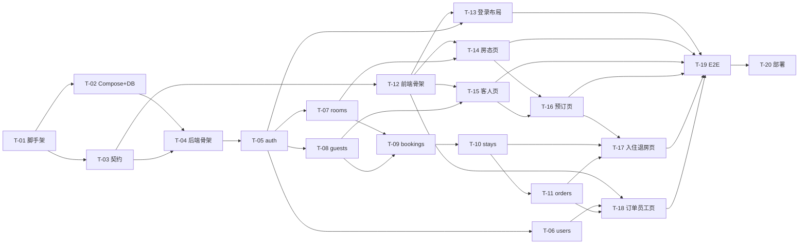

# 开发计划 — 酒店管理系统（HMS）

| 项 | 值 |
| --- | --- |
| 文档版本 | v1.0（待评审，未冻结） |
| 日期 | 2026-10-14 |
| 拆分原则 | 每个任务可独立验收（有明确 DoD + 自动化检查）；先后端契约与核心域、后前端页面、最后端到端与部署；任何任务不改变冻结契约（除非走变更评审） |

> **2026-10-18 状态更新**：需求基线 v1.0 已批准（[批准工作稿](./requirements-traceability-approval-draft.md)）。Q-04 A 维持统计看板等 V2 范围外；A-20 B 首登强制改密、T-17 的 walk-in 前端入口与 T-19 Playwright E2E 均已实现。当前行动项见 [`post-approval-action-register.md`](./post-approval-action-register.md)。

## 里程碑

| 里程碑 | 任务 | 出口条件 |
| --- | --- | --- |
| M1 基础设施与契约 | T-01 ~ T-04 | compose 起、契约文件评审通过、CI 全绿 |
| M2 后端核心域 | T-05 ~ T-11 | 全部 API 集成测试通过（含并发用例） |
| M3 前端 | T-12 ~ T-18 | 全部页面可用、类型检查/单测通过 |
| M4 端到端与交付 | T-19 ~ T-20 | Playwright 主流程通过、生产 compose 验收 |

通用验收门禁（每任务）：`pnpm -r typecheck` + `pnpm -r lint` + 相关测试真实通过；文档与实现一致；无未披露问题（协议 §七）。

---

## M1 基础设施与契约

### T-01 Monorepo 脚手架与工具链

- **依赖**：无
- **涉及**：根目录 `pnpm-workspace.yaml`、`package.json`、`tsconfig.base.json`、`.eslintrc`/`eslint.config.js`、`.prettierrc`、`.gitignore`、`packages/shared/`、`apps/server/`、`apps/web/` 骨架、CI workflow
- **预期修改**：初始化 pnpm workspace 三包骨架；TS strict；ESLint（含 `vue/no-v-html`、`no-restricted-imports` 分层规则）+ Prettier；Vitest workspace 配置；CI（lint/typecheck/test/audit）。
- **验收标准**：`pnpm install && pnpm -r typecheck && pnpm -r lint` 全绿；shared 包可被两端 `import`；CI 在示例测试上跑通。
- **自动化测试**：冒烟单测各 1 个（shared 纯函数）。
- **回滚**：git revert 脚手架提交（无业务影响）；**附加**：本任务必须完成 Prisma 7 与 Node 22/Express 编译链的 PoC（ADR-003 风险项），不兼容则在此刻上报证据。

### T-02 Docker Compose + MySQL + Prisma 初始迁移

- **依赖**：T-01
- **涉及**：`docker-compose.yml`、`compose.prod.yml`、`apps/server/prisma/schema.prisma`（全表）、`prisma/migrations/0001_init/`、`prisma/seed.ts`、`.env.example`
- **预期修改**：mysql 8.4 容器（utf8mb4、TZ=Asia/Shanghai）；schema 落库；CHECK 约束以手写迁移 SQL 补充（database-design §7）；seed 读取 `ADMIN_INITIAL_PASSWORD`。
- **验收标准**：`docker compose up -d` 后 `prisma migrate deploy` 幂等成功；`SHOW CREATE TABLE` 核对唯一键/索引/CHECK 与 database-design 一致；seed 仅空表执行。
- **自动化测试**：CI 中 MySQL service 容器跑 `prisma migrate deploy` + seed 断言（连接性、唯一键存在性）。
- **回滚**：销毁卷重建（开发期）；生产前滚式迁移（database-design §7.4）。

### T-03 契约冻结第一版：openapi.yaml + @hms/shared

- **依赖**：T-01（T-02 可并行）
- **涉及**：`openapi/openapi.yaml`、`packages/shared/src/`（types、zod schemas、STATES/TRANSITIONS、errorCodes、permissions、分页排序白名单）、`docs/api-contract.md` 复核
- **预期修改**：产出完整 OpenAPI 3.0.3 规范与共享包；`@redocly/cli lint` 纳入 CI。
- **验收标准**：lint 0 error；shared 类型与 yaml 字段逐一对应（评审清单）；zod schema 能解析 api-contract 全部请求示例。
- **自动化测试**：Vitest——每个请求示例经对应 zod schema `parse` 通过、非法示例被拒。
- **回滚**：git revert（纯文件变更）。

### T-04 后端骨架：app 工厂、中间件、日志、配置

- **依赖**：T-01、T-02
- **涉及**：`apps/server/src/{main,app}.ts`、`config/env.ts`、`shared/middleware/{requestId,requestLogger,csrf,errorHandler,validate}.ts`、`shared/http/ApiError.ts`、`lib/prisma.ts`、`utils/logger.ts`
- **预期修改**：Express app 工厂（可注入依赖便于测试）；requestId + pino-http（redact）；zod 校验中间件；统一错误处理（ApiError/ZodError/Prisma P2002/P2025 映射）；`GET /api/health`。
- **验收标准**：Supertest 验证错误信封格式、X-Request-Id 头、redact 生效、env 缺失 fail fast。
- **自动化测试**：`tests/app.spec.ts`（畸形 body→400、未知路由→404、错误响应格式）。
- **回滚**：git revert；无库变更。

---

## M2 后端核心域

### T-05 认证模块（auth）

- **依赖**：T-04、T-03
- **涉及**：`apps/server/src/modules/auth/`（routes/controller/service）、`shared/middleware/{session,requireAuth,requireRole,rateLimit}.ts`、`utils/password.ts`
- **预期修改**：A1~A3 端点；session 生命周期（创建/校验/登出/定时清理）；登录失败锁定 + IP 限流；恒定时间比较。
- **验收标准**：api-contract A1~A3 全部测试通过；`requireAuth/requireRole` 默认拒绝。
- **自动化测试**：TC-AUTH-001~006、TC-SEC-001/004/009（Supertest + 真库）。
- **回滚**：git revert；无迁移变更。

### T-06 员工模块（users，ADMIN）

- **依赖**：T-05
- **涉及**：`apps/server/src/modules/users/`
- **预期修改**：U1~U4 端点；停用/重置密码的会话失效副作用；"不能停用自己"。
- **验收标准**：api-contract U1~U4 测试通过。
- **自动化测试**：TC-USER-001~009、TC-SEC-002/003。
- **回滚**：git revert。

### T-07 房型与客房模块（room-types / rooms）

- **依赖**：T-05
- **涉及**：`apps/server/src/modules/{room-types,rooms}/`
- **预期修改**：R1~R4、M1~M5 端点；房态状态机（shared TRANSITIONS）；房量影响操作先锁房型行的对称规则（database-design §6.1）。
- **验收标准**：api-contract R/M 全部测试通过；归档保护规则生效。
- **自动化测试**：TC-RT-001~007、TC-RM-001~012、TC-SEC-008（排序注入）。
- **回滚**：git revert。

### T-08 客人模块（guests）

- **依赖**：T-05、T-03（加密工具入 shared？——否，加密仅服务端：`apps/server/src/utils/crypto.ts`）
- **涉及**：`apps/server/src/modules/guests/`、`utils/crypto.ts`
- **预期修改**：G1~G4 端点；AES-256-GCM 加解密、HMAC 查重、掩码生成；证件不可改规则。
- **验收标准**：api-contract G1~G4 测试通过；库中无明文证件（测试直查库断言）。
- **自动化测试**：TC-GS-001~009、TC-SEC-006/010。
- **回滚**：git revert。

### T-09 预订模块（bookings）★ 并发关键

- **依赖**：T-07、T-08
- **涉及**：`apps/server/src/modules/bookings/`（含 `repository` 内锁读 SQL）
- **预期修改**：B1~B5 端点；`createBooking/cancel/noShow` 事务（房型行锁 + 重叠计数，database-design §6.1 伪代码逐条落实）。
- **验收标准**：api-contract B1~B5 测试通过；**并发测试**：2 房房型并发 10 个创建请求仅 2 成功；取消后可重订。
- **自动化测试**：TC-BK-001~015（Vitest + Supertest + `Promise.all` 并发用例）。
- **回滚**：git revert；无迁移变更（锁逻辑纯应用层）。

### T-10 入住模块（stays）★ 并发关键

- **依赖**：T-09
- **涉及**：`apps/server/src/modules/stays/`（`createStay` 核心供 B6/S1 复用）
- **预期修改**：B6、S1、S2、S3 端点；房间行锁 + occupancy 批量插入 + `UNIQUE(room_id,date)` 冲突翻译为 `ROOM_OCCUPIED`；一订一住唯一约束利用。
- **验收标准**：api-contract B6/S1~S3 测试通过；并发同房双入住仅一次成功（唯一约束兜底用例）。
- **自动化测试**：TC-BK-016~021、TC-SY-001~008。
- **回滚**：git revert。

### T-11 退房与订单模块（orders）

- **依赖**：T-10
- **涉及**：`apps/server/src/modules/orders/`、`stays/checkout` 扩展
- **预期修改**：S4、O1、O2 端点；退房事务（database-design §6.3 全步骤）；计费与押金抵扣；释放占用行。
- **验收标准**：api-contract S4/O1/O2 测试通过；重复退房 409；退房后当日可再售（M2 回归）。
- **自动化测试**：TC-SY-009~013、TC-OD-001~003。
- **回滚**：git revert。

---

## M3 前端

### T-12 前端脚手架与基础设施

- **依赖**：T-03
- **涉及**：`apps/web/` 全骨架、`src/api/request.ts`、`stores/`、`router/`、`layouts/`、`components/DataPage.vue` 等
- **预期修改**：Vite + Vue3 + TS strict；axios 封装（拦截器全分支）；路由守卫骨架；Pinia stores；`usePagedList/useFormSubmit`；v-permission 指令；三态组件。
- **验收标准**：`pnpm --filter web typecheck && lint` 通过；MSW mock（若用）或直连 T-05 后端跑通登录页。
- **自动化测试**：Vue Test Utils——拦截器 401 跳转、DataPage 三态渲染、v-permission 指令。
- **回滚**：git revert。

### T-13 登录与布局

- **依赖**：T-12、T-05
- **涉及**：`views/login/`、`layouts/DefaultLayout.vue`、菜单配置
- **预期修改**：登录页（校验/错误提示/锁定提示）；启动会话重建（fetchMe）；菜单按角色过滤；登出。
- **验收标准**：完整登录-登出闭环；刷新不丢会话；401 自动跳转带 redirect。
- **自动化测试**：组件测试（表单校验、错误分支）+ 手动验收记录。
- **回滚**：git revert。

### T-14 房型与客房页面

- **依赖**：T-12、T-07
- **涉及**：`views/rooms/`、`views/room-types/`、`api/rooms.ts`、`api/room-types.ts`
- **预期修改**：房态看板（分组卡片、在住摘要、状态操作按钮按角色渲染）；房型管理 CRUD + 归档确认。
- **验收标准**：api-contract R/M 对应页面全部可操作；非法操作后端拒绝时前端提示正确。
- **自动化测试**：组件测试（StatusTag 映射、角色按钮渲染）、关键表单 zod 校验单测。
- **回滚**：git revert。

### T-15 客人页面

- **依赖**：T-12、T-08
- **涉及**：`views/guests/`、`api/guests.ts`、`components/GuestPicker.vue`
- **预期修改**：档案列表（关键字/分页）、新建（查重 409 → 引导选用已有档案）、编辑（证件只读）。
- **验收标准**：G1~G4 页面闭环；证件恒掩码展示。
- **自动化测试**：GuestPicker 交互测试、409 分支处理测试。
- **回滚**：git revert。

### T-16 预订页面

- **依赖**：T-14、T-15（GuestPicker）、T-09
- **涉及**：`views/bookings/`、`api/bookings.ts`
- **预期修改**：列表（筛选/分页/状态流转操作）、创建对话框（日期区间、房型、价格预览）、详情页；SOLD_OUT 409 提示与可用量引导。
- **验收标准**：B1~B5 页面闭环；创建后房态看板数量联动刷新。
- **自动化测试**：表单校验（日期倒挂/过期）、409 分支 UI 反馈测试。
- **回滚**：git revert。

### T-17 入住与退房页面

- **依赖**：T-16、T-10、T-11
- **涉及**：`views/stays/`、`components/{RoomPicker,CheckoutDialog}.vue`、`api/stays.ts`
- **预期修改**：在住列表 + walk-in 入住对话框；预订详情"办理入住"（RoomPicker 按可用房过滤）；退房结算对话框（费用预览、杂费动态行、押金抵扣展示、支付方式选择）。
- **验收标准**：B6/S1~S4 页面闭环；退房后房间状态与可售量即时更新。
- **自动化测试**：CheckoutDialog 计费预览计算测试、RoomPicker 过滤逻辑测试。
- **回滚**：git revert。

### T-18 订单与员工页面

- **依赖**：T-12、T-11、T-06
- **涉及**：`views/orders/`、`views/users/`、`api/orders.ts`、`api/users.ts`
- **预期修改**：订单查询/详情（只读）；员工管理（ADMIN 路由与菜单）。
- **验收标准**：O1/O2、U1~U4 页面闭环；RECEPTIONIST 访问 /users 路由 → 403 页。
- **自动化测试**：路由守卫角色分支测试。
- **回滚**：git revert。

---

## M4 端到端与交付

### T-19 Playwright 端到端测试

- **依赖**：T-13 ~ T-18
- **涉及**：`e2e/`（独立包或 apps/server/test/e2e）、Playwright config、CI job
- **预期修改**：主流程 E2E——登录 → 建客人 → 建预订（含 SOLD_OUT 分支）→ 预订入住 → 退房结算 → 订单核对；walk-in 流程；权限路径（RECEPTIONIST 访问管理页 403）。
- **验收标准**：CI 中对 compose 环境全部 E2E 通过且录频留档。
- **自动化测试**：E2E 本身（`TC-E2E-001~005`）。
- **回滚**：git revert；E2E 失败修复优先级高于新功能。

### T-20 生产部署配置与验收

- **依赖**：T-19
- **涉及**：`compose.prod.yml`、Nginx 配置（静态托管 + /api 反代 + 安全头）、部署文档 `docs/deployment.md`、运维手册（备份/恢复/日志）
- **预期修改**：生产 compose（非 root、healthcheck、资源限制、只暴露 80/443、mysql 不映射宿主端口）；`prisma migrate deploy` 启动流程；备份脚本。
- **验收标准**：全新主机按文档 30 分钟内一键拉起并通过 E2E 冒烟；密钥零入库（gitleaks 通过）。
- **自动化测试**：部署后冒烟脚本（health + 登录 + 核心只读接口）。
- **回滚**：回退镜像 tag 重新 `compose up`（迁移前滚注意 database-design §7.4）。

---

## 依赖关系图

## 风险任务与缓冲

| 风险 | 任务 | 缓冲 |
| --- | --- | --- |
| Prisma 7 兼容性 PoC 失败 | T-01/T-02 | 预留降级评估 0.5 天，按协议上报变更 |
| 并发正确性反复 | T-09/T-10 | 每个并发用例独立提交；失败用例不得删改预期（协议 §五） |
| Element Plus 组件行为与设计偏差 | T-17 | CheckoutDialog 复杂表单预留设计复核 |

